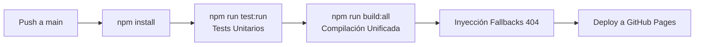

# 🌐 zn-apps — Multi-PWA Monorepo

> Monorepo de **Progressive Web Applications (PWAs)** independientes construidas con **Vue 3**, **Vite** y **Material Design 3**, orquestadas mediante **npm workspaces** y desplegadas automáticamente en **GitHub Pages**.

---

## 📱 Aplicaciones y Proyectos

El monorepo aloja un ecosistema de aplicaciones autónomas y una librería compartida de interfaz de usuario:

| Proyecto | Carpeta | Rol / Descripción | Estado | Ruta / Base URL |
|---|---|---|---|---|
| **Landing Portal** | `/` (`index.html`) | Portal de bienvenida para seleccionar y lanzar cada PWA | Producción | `/zn-apps/` |
| **@zn-apps/shared** | [`shared/`](./shared) | Librería central de componentes UI (MD3), tokens CSS, composables y utilidades | Activo | N/A (librería ES) |
| **Zound Box** | [`zound-box/`](./zound-box) | Primera aplicación interactiva del monorepo (reproductor / caja de sonidos) | Activo | `/zn-apps/zound-box/` |
| **Dev Kitchensink** | [`kitchensink/`](./kitchensink) | Catálogo interactivo de componentes y **plantilla oficial** para nuevas apps | Activo | `/zn-apps/kitchensink/` |
| **PWA App 2** | [`pwa-app2/`](./pwa-app2) | Template legacy inicial de Vite (en proceso de retiro futuro) | Legacy | `/zn-apps/pwa-app2/` |

---

## 🛠️ Requisitos Previos

- **Node.js**: Versión **24.x** (recomendada) o superior (soporta v20+).
- **npm**: Versión **10.x** o superior (con soporte nativo para `workspaces`).

---

## 🚀 Instalación

Gracias a **npm workspaces**, todas las dependencias del monorepo y sus subproyectos se instalan desde la raíz en un único paso:

```bash
# 1. Clonar el repositorio
git clone https://github.com/<usuario>/zn-apps.git
cd zn-apps

# 2. Instalar todas las dependencias unificadas
npm install
```

---

## 💻 Desarrollo Local

Puedes levantar el servidor de desarrollo de Vite para cualquiera de las aplicaciones de dos formas: usando el flag `--workspace` desde la raíz o entrando a la subcarpeta.

### Opción 1: Comandos directos desde la raíz (Recomendado)

```bash
# Levantar el catálogo Kitchensink
npm run dev --workspace=kitchensink

# Levantar Zound Box
npm run dev --workspace=zound-box

# Compilar la librería shared en modo watch (detecta cambios en vivo)
npm run dev --workspace=shared
```

### Opción 2: Navegando a la subcarpeta

```bash
# Para Kitchensink
cd kitchensink
npm run dev

# Para Zound Box
cd ../zound-box
npm run dev

# Para la librería shared
cd ../shared
npm run dev
```

> 💡 **Nota sobre la librería compartida:** Para el desarrollo de nuevas características en `@zn-apps/shared`, puedes correr `npm run dev --workspace=shared` para que Vite recompile automáticamente ante cualquier modificación en `shared/src/`.

---

## 🧪 Testing Unitario

El monorepo cuenta con una suite centralizada de pruebas con **Vitest**, **@vue/test-utils** y **happy-dom**:

```bash
# Ejecutar todos los tests en modo interactivo (watch)
npm test

# Ejecutar todos los tests una sola vez (modo CI)
npm run test:run

# Generar reporte de cobertura de código (V8)
npm run test:coverage

# Ejecutar tests de un paquete en específico:
npm run test:shared       # Solo componentes y utilidades de @zn-apps/shared
npm run test:zound-box    # Solo la aplicación Zound Box
npm run test:kitchensink  # Solo la aplicación Kitchensink y su router
```

---

## 📦 Compilación para Producción (Build)

### Compilación Unificada (Todo el Monorepo)

Para generar la distribución completa lista para producción en la carpeta `dist/`:

```bash
npm run build:all
```

**¿Qué hace este script?**
1. Limpia y crea la carpeta `dist/`.
2. Copia la landing page (`index.html`) y el Service Worker raíz (`sw.js`).
3. Compila `@zn-apps/shared` en modo librería.
4. Compila `zound-box`, `pwa-app2` y `kitchensink`.
5. Mueve cada `dist/` a su subcarpeta correspondiente dentro de la raíz `dist/`.

### Compilación Individual por Proyecto

```bash
npm run build:shared       # Compila @zn-apps/shared -> shared/dist/
npm run build:zound-box    # Compila Zound Box -> zound-box/dist/
npm run build:kitchensink  # Compila Kitchensink -> kitchensink/dist/
npm run build:app2         # Compila pwa-app2 -> pwa-app2/dist/
```

---

## 🚢 CI/CD y Despliegue en GitHub Pages

El repositorio cuenta con un flujo automatizado de integración y despliegue continuo mediante **GitHub Actions** en [`.github/workflows/deploy.yml`](./.github/workflows/deploy.yml):



1. **Disparador:** Cada `git push` a la rama `main`.
2. **Entorno:** Ubuntu con Node.js 24 y cache de npm.
3. **Control de Calidad:** Ejecuta `npm run test:run`. Si alguna prueba unitaria falla, el despliegue se cancela inmediatamente.
4. **Build & Fallbacks:** Genera la carpeta `dist/` e inyecta los archivos `404.html` para resolver enrutamiento en SPAs.
5. **Publicación:** Publica los artefactos directamente en GitHub Pages bajo `/zn-apps/`.

---

## 📁 Estructura del Repositorio

```
zn-apps/
├── .github/
│   └── workflows/
│       └── deploy.yml        # Workflow de CI/CD para GitHub Pages
├── docs/                     # 📚 Documentación técnica detallada y de arquitectura
├── index.html                # Landing portal general
├── sw.js                     # Service Worker raíz para la landing
├── package.json              # Configuración de workspaces y scripts globales
├── vitest.config.js          # Configuración global de Vitest (proyectos)
├── vitest.setup.js           # Mocks globales de entorno para tests
│
├── shared/                   # 📦 Librería de componentes y utilidades compartidas
│   ├── src/
│   │   ├── components/       # Componentes Vue 3 (ZnButton, ZnCard, ZnSwitch, etc.)
│   │   ├── composables/      # useOnlineStatus
│   │   ├── utils/            # helpers (formatDate)
│   │   └── assets/css/       # global.css y tokens MD3
│   └── vitest.config.js
│
├── zound-box/                # 🎵 App productiva de audio / PWA independiente
│   ├── src/
│   └── vitest.config.js
│
├── kitchensink/              # 🧬 Catálogo visual de componentes y template base
│   ├── src/
│   │   ├── router/           # Enrutamiento con vue-router
│   │   └── views/            # Vistas demostrativas
│   └── vitest.config.js
│
└── pwa-app2/                 # 🗂️ Plantilla boilerplate legacy
```

---

## 📚 Documentación Técnica Adicional

Para más detalles sobre la arquitectura interna, componentes y convenciones, consulta los documentos en la carpeta [`docs/`](./docs):

- [**`docs/00-overview.md`**](./docs/00-overview.md): Visión general de arquitectura, dependencias y reglas de monorepo.
- [**`docs/01-shared.md`**](./docs/01-shared.md): API completa de componentes, props, slots, eventos y tokens CSS.
- [**`docs/02-app-zound-box.md`**](./docs/02-app-zound-box.md): Contexto y arquitectura de la aplicación Zound Box.
- [**`docs/03-app-kitchensink.md`**](./docs/03-app-kitchensink.md): Guía de Kitchensink y checklist para crear nuevas apps.
- [**`docs/04-legacy-templates.md`**](./docs/04-legacy-templates.md): Información sobre las plantillas legacy y su retiro.
- [**`docs/05-testing.md`**](./docs/05-testing.md): Guía completa de testing unitario y mocks con Vitest.

---

## 🤖 Contexto para Agentes de IA

Si eres un modelo o agente de IA trabajando en este repositorio (Antigravity, Cursor, Copilot, etc.), consulta los archivos de instrucciones automáticas en la raíz:
- [**`AGENTS.md`**](./AGENTS.md)
- [**`GEMINI.md`**](./GEMINI.md)
