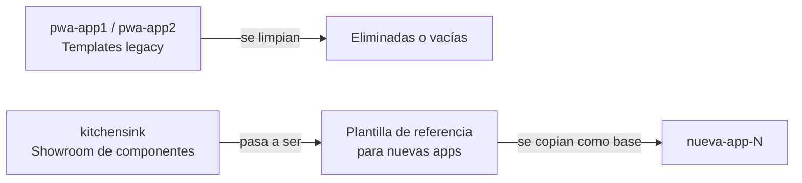

# Templates Legacy — pwa-app1 y pwa-app2

> Documento de contexto rápido para IA. Actualizado: 2026-10-28.

## Propósito de este Documento

`pwa-app1` y `pwa-app2` son las subcarpetas **legacy** que sirvieron de base inicial para el monorepo. Son plantillas boilerplate generadas por Vite + Vue que NO usan `@zn-apps/shared` ni tienen funcionalidad real de negocio.

**Su rol futuro es desaparecer.** `kitchensink` reemplazará su función como plantilla.

---

## Estado Actual

| App | Estado | En workspace | En build:all | Usa shared |
|---|---|---|---|---|
| `pwa-app1` | 🗑️ Vacío / sin contenido relevante | No | No (no en scripts) | No |
| `pwa-app2` | 🗑️ Boilerplate Vite | Sí (`package.json` workspace) | Sí (se buildea) | No |

---

## pwa-app1

- **Carpeta:** `pwa-app1/`
- **Contenido:** No aparece en los workspaces del root `package.json`. Probablemente vacío o incompleto.
- **Estado:** Ignorar para desarrollo. Candidato a eliminar.

---

## pwa-app2

### Descripción
Boilerplate puro de Vite + Vue 3. No usa ningún componente de `@zn-apps/shared`. Muestra la pantalla de bienvenida estándar de Vite.

### Stack
- Vue 3 ~3.5.34
- Vite ~5.0
- vite-plugin-pwa ~0.20.0
- **Sin** `@zn-apps/shared`
- **Sin** vue-router
- **Sin** Pinia

### Estructura
```
pwa-app2/
├── index.html
├── package.json      # name: "pwa-app2"
├── vite.config.js
└── src/
    ├── main.js
    ├── App.vue       # Solo renderiza HelloWorld
    ├── style.css
    └── components/
        └── HelloWorld.vue   # Pantalla default de Vite
```

### Componente HelloWorld.vue
Pantalla boilerplate con:
- Logo de Vite + Vue
- Contador con `ref(0)` y botón
- Links a documentación de Vite y comunidad

```js
const count = ref(0)
```

### Por qué sigue en el build
Está en `workspaces` y en `build:all` probablemente para mantener el pipeline funcional mientras se migra. No tiene funcionalidad de negocio.

---

## Plan de Migración (Futuro)



### Pasos recomendados al crear una nueva app:
1. Copiar la estructura de `kitchensink/` como base.
2. Renombrar el paquete en `package.json`.
3. Actualizar `vite.config.js` con la nueva `base` URL y manifest PWA.
4. Limpiar las vistas de ejemplo y adaptar al caso de uso real.
5. Registrar en `workspaces` del root y en `build:all`.

---

## Nota para IA

> Si recibes una tarea relacionada con `pwa-app1` o `pwa-app2`, ten en cuenta que **no representan el estado objetivo** del proyecto. Úsalos solo como referencia de lo que NO debe ser una app productiva en este monorepo. Toda app nueva debe seguir el patrón de `kitchensink` y usar `@zn-apps/shared`.
